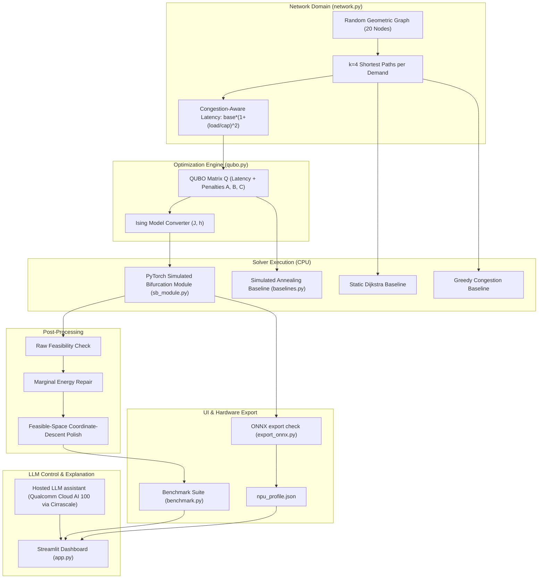

# Quantum-Inspired Network Route Optimizer (Infosys EngNext)

## 📌 Executive Summary
**Quantum-Inspired Network Route Optimizer** is a prototype developed for Infosys EngNext. It formulates multi-flow network routing under congestion, latency, and link failure constraints as a **Quadratic Unconstrained Binary Optimization (QUBO)** problem. The QUBO is mapped to an **Ising Spin Model** and solved using **Discrete Simulated Bifurcation (dSB)** implemented as a static PyTorch graph executing on CPU. A hosted LLM assistant running on **Qualcomm Cloud AI 100 Ultra** (via Cirrascale Inference Cloud) provides natural-language scenario control and result explanations.

---

## 🏛️ System Architecture



---

## 🚀 How to Run

### 1. Prerequisites & Installation
Ensure Python 3.11+ is installed. Install required packages:
```bash
pip install torch numpy networkx streamlit plotly pytest
```

### 2. Run Automated Unit Tests
Verify mathematical formulation, Ising conversion, SB output shape, and decode repair:
```bash
python -m pytest test_solver.py -v
```

### 3. Verify TorchScript Trace and ONNX Export
Trace the PyTorch module and confirm traced graph outputs match eager execution:
```bash
python export_onnx.py --trace-only
```

*(Optional)* Submit model to external profiling API check (not used for any reported result in this project):
```bash
python export_onnx.py --submit --device <target_device>
```

### 4. Run Benchmark Suite
Run evaluation across 5 network scenarios and save results to `results.json`:
```bash
python benchmark.py
```

### 5. Launch Interactive Streamlit Dashboard
Launch the dashboard to visualize interactive comparative routes, test link failure injection, and inspect ablation charts:
```bash
streamlit run app.py
```

---

## ⚠️ Honest Technical Limitations

1. **Quantum-INSPIRED, Not Quantum Physics**:
   - Simulated Bifurcation (SB) is a **classical non-linear oscillator algorithm** solved via numerical integration (Euler/Runge-Kutta). It runs entirely on classical CPU hardware.
2. **Fixed Tensor Shapes & Padding**:
   - The PyTorch module uses fixed tensor dimensions ($128 \times 128$) to allow static graph tracing (`torch.jit.trace`) for hardware compilers. Larger problem sizes require scaling tensor dimensions or zero-padding.
3. **NP-Hard QUBO Approximations**:
   - Congestion cost $\left(\frac{\text{load}}{\text{capacity}}\right)^2$ is non-linear and approximated in QUBO by pairwise variable interaction terms.

---

## 📢 Claims We CAN and CANNOT Make

### ✅ Claims We CAN Make:
* **"Quantum-Inspired Algorithm"**: Uses Simulated Bifurcation dynamics inspired by quantum adiabatic evolution and Kerr-nonlinear parametric oscillators.
* **"ONNX Exportable PyTorch Solver"**: The solver traces to a static graph that matches eager output and exports to ONNX; NPU compilation and profiling were not tested. The routing solver itself runs on CPU in PyTorch.
* **"Hosted LLM Assistant"**: Natural language parsing and explanation use hosted LLMs (Llama-3.1-8B / Llama-3.3-70B) on Qualcomm Cloud AI 100 Ultra via Cirrascale Inference Cloud.
* **"Congestion-Aware Routing Quality"**: SB with coordinate-descent polish matches or outperforms Greedy Routing on maximum link utilization and overloaded links under heavy congestion.
* **"FP32 vs FP16 Precision Parity"**: Running SB in FP16 precision preserves routing quality on CPU while reducing memory footprint.
* **"Honest Hardware Metrics"**: Latency, memory, and compute coverage are only reported when genuinely measured by a real profiler; otherwise explicitly reported as "Not measured".

### ❌ Claims We CANNOT Make (Avoid Everywhere):
* ❌ **Do NOT claim solver runs on or is accelerated by Qualcomm hardware**: The routing solver executes on CPU. Only the hosted LLM assistant uses Qualcomm Cloud AI 100 via Cirrascale.
* ❌ **Do NOT claim any NPU speed, memory, or coverage figure**: NPU compilation and hardware profiling of the solver were not performed.
* ❌ **Do NOT claim use of Qualcomm AI Hub**: Qualcomm AI Hub was not used for any reported result in this project.
* ❌ **Do NOT claim quantum physics advantage or supremacy**: The algorithm runs on classical silicon.
* ❌ **Do NOT claim "Exact Global Optimum Guaranteed"**: QUBO solvers are metaheuristics and do not guarantee exact global optimality on large instances.
* ❌ **Do NOT claim "Zero Feasibility Violations in Raw Output"**: Raw SB output may violate one-hot path constraints before repair decoding.
